# Dikshant Neupane

  <picture>
    <source media="(prefers-color-scheme: dark)" srcset="./assets/dark.svg" />
    <source media="(prefers-color-scheme: light)" srcset="./assets/light.svg" />
    
  </picture>

Aspiring data scientist. I turn raw data into models, analysis, and decisions.

<a href="mailto:dikshantneupane690@gmail.com">Email</a> • <a href="https://www.linkedin.com/in/dikshant-neupane-a64b09326/">LinkedIn</a> • <a href="https://www.kaggle.com/nforneura">Kaggle</a> • <a href="https://github.com/Dikshant-Neupane">GitHub</a>

---

## Currently

- Building machine learning and analytics projects in Python, from data collection and cleaning to modeling and reporting.
- Contributing to open source across Python, TypeScript, and Rust projects.

## About

I am a BSc CSIT student at Samriddhi College, Tribhuvan University, aiming for a career in data science. My interests are machine learning, data analytics, and natural language processing, backed by Python, statistics, and SQL.

## Featured Data Projects

### [CricNepal](https://github.com/Dikshant-Neupane/CricNepal)

Nepal cricket data and analytics, actively maintained.

**Focus:** Sports Analytics, Data Collection, Reporting

### [House Price Prediction](https://github.com/Dikshant-Neupane/House_price_prediction)

Predicting house prices with machine learning.

**Focus:** Regression, scikit-learn, Feature Engineering

### [Election 2082](https://github.com/Dikshant-Neupane/Election-2082)

Analysis of Nepal's 2082 election data.

**Focus:** Civic Data, Analysis, Visualization

### [Jana Sunuwaai](https://github.com/Dikshant-Neupane/Jana_Sunuwaai)

Natural language processing project.

**Focus:** NLP, Machine Learning

More data work: [First_DS](https://github.com/Dikshant-Neupane/First_DS), my first data science project, and [Cric_Data](https://github.com/Dikshant-Neupane/Cric_Data), cricket datasets.

## Data Stack

  
  
  
  
  
  

  

## Open Source

I contribute bug fixes, tests, and documentation to open source repositories, mostly in Python, with recent work in TypeScript and Rust.

## Leadership & Activities

- Marketing Head, Hult Prize Nepal
- Hackathon Participant
- Open Source Contributor
- Independent Project Builder

## GitHub Statistics

  
  

  

## Contribution Activity

  

## Philosophy

> Build useful things.
>
> Learn continuously.
>
> Share knowledge.
>
> Improve every day.

## Connect

- Email: [dikshantneupane690@gmail.com](mailto:dikshantneupane690@gmail.com)
- LinkedIn: <https://www.linkedin.com/in/dikshant-neupane-a64b09326/>
- Kaggle: <https://www.kaggle.com/nforneura>
- GitHub: <https://github.com/Dikshant-Neupane>
